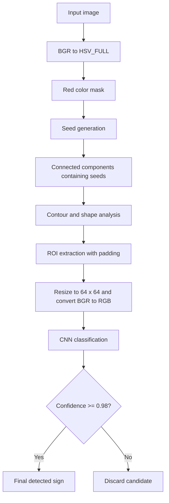

# Traffic Sign Detection and Classification

A computer vision and machine learning project that detects and classifies selected traffic signs from images. The system combines traditional image processing with a Convolutional Neural Network (CNN).

> **Project type:** Master's thesis / Computer Vision / Machine Learning  
> **Status:** Research prototype  
> **Classes:** 9

## Overview

The project implements a pipeline for detecting and classifying nine traffic-sign classes: speed limits 20, 30, 50, 60, 70, 80, 100 and 120, plus STOP.

The system first identifies candidate regions using red-color segmentation, filters them by geometric characteristics, and then uses a CNN to classify the remaining regions.

## Key Features

- Red-color segmentation in OpenCV's `HSV_FULL` color space.
- Seed generation in image blocks and connected-component extraction.
- Contour and convex-hull analysis.
- Geometric features including ellipticity, octagonality, circularity, solidity, polygon approximation, and ellipse fitting.
- CNN classification of candidate regions into nine classes.
- Final confidence threshold of `0.98`.
- CNN training with data augmentation, validation, callbacks, and model checkpointing.

## Pipeline



## Technologies

- **Python**
- **OpenCV** — image processing, color conversion, contours, connected components
- **NumPy** — numerical and array operations
- **TensorFlow / Keras** — CNN training and inference
- **GTSRB** — source dataset for the selected classes

## CNN Architecture

The classifier accepts RGB images resized to `64 × 64` pixels. Its main structure consists of:

1. Three convolutional blocks with 32, 64, and 128 filters.
2. Batch normalization and max pooling.
3. Dropout for regularization.
4. Global average pooling.
5. A dense layer with 128 units.
6. A 9-unit softmax output layer.

Input scaling is performed inside the model using `Rescaling(1/255)`. Training uses Adam, sparse categorical cross-entropy, and accuracy as a metric. Callbacks provide early stopping, model checkpointing, and learning-rate reduction.

## Results

The CNN reached approximately **98–99% validation accuracy** on the selected dataset split, based on the recorded training curves.

**Important:** this is the CNN's validation result, not a measured end-to-end accuracy for the complete detection pipeline. The complete system can miss a sign during segmentation or geometric filtering before the CNN receives the region.

The confidence threshold is set to `0.98`. It can reduce uncertain predictions, but may also reject correctly classified signs whose confidence is below the threshold.

## Limitations

- Detection depends on red-color segmentation and fixed HSV thresholds.
- Lighting changes, shadows, reflections, faded signs, and small or distant signs can affect segmentation.
- Perspective distortion, occlusion, and irregular contours may cause valid signs to fail geometric filtering.
- Errors in earlier stages cannot be recovered by the CNN.
- The model supports only the nine listed classes.
- This is a research prototype, not a safety-certified or production-ready automotive system.

## Getting Started

### Requirements

- Python 3.11 or a version supported by the TensorFlow version used in the project
- `pip`
- OpenCV, NumPy, TensorFlow, and any other dependencies used by the code

### 1. Clone the repository

```bash
git clone <YOUR_REPOSITORY_URL>
cd <YOUR_REPOSITORY_DIRECTORY>
```

### 2. Create a virtual environment

**Windows (PowerShell):**

```powershell
py -3.11 -m venv .venv
.\.venv\Scripts\Activate.ps1
```

**Linux / macOS:**

```bash
python3.11 -m venv .venv
source .venv/bin/activate
```

### 3. Install dependencies

If the repository contains `requirements.txt`:

```bash
python -m pip install --upgrade pip
pip install -r requirements.txt
```

If it does not, create one with the tested dependency versions before publishing the project.

### 4. Prepare the dataset

The training code expects class-specific directories under `data/train/`, for example:

```text
data/
└── train/
    ├── limit_20/
    ├── limit_30/
    ├── limit_50/
    ├── limit_60/
    ├── limit_70/
    ├── limit_80/
    ├── limit_100/
    ├── limit_120/
    └── stop/
```

Verify that these directory names match the actual dataset and the class order in the code.

### 5. Train the CNN

Run the training script from the repository root. Replace `<training_script>.py` with the actual filename:

```bash
python <training_script>.py
```

The training configuration uses 64 × 64 images, batch size 32, a 70/30 training/validation split, and a maximum of 50 epochs. Early stopping may end training sooner. The model is saved as `traffic_sign_cnn.keras`.

### 6. Run detection

Replace `<detection_script>.py` with the actual detection script filename:

```bash
python <detection_script>.py
```

The detection script should load `traffic_sign_cnn.keras`. Check how the script selects its input image or accepts command-line arguments.

> Before publishing, replace the script placeholders with the real filenames and verify the commands in a clean environment. Do not commit the virtual environment or large dataset files unless you intentionally want to distribute them.

## Suggested Repository Structure

This is a suggested layout; adapt it to the files you actually publish.

```text
traffic-sign-detection/
├── README.md
├── requirements.txt
├── .gitignore
├── src/
│   ├── train.py
│   └── detect.py
├── data/
│   └── train/
│       └── <class_name>/
├── models/
│   └── traffic_sign_cnn.keras
├── examples/
│   ├── input/
│   └── output/
└── docs/
    └── thesis.pdf
```

## Future Improvements

- Expand the dataset and support additional traffic-sign classes.
- Improve robustness under changing lighting, weather, perspective, and partial occlusion.
- Evaluate the complete pipeline on a separate labeled test set.
- Report end-to-end precision, recall, F1-score, and detection rate separately from CNN validation accuracy.
- Compare confidence thresholds and their effect on false positives and missed signs.
- Add video-stream processing and tracking across consecutive frames.
- Explore optimization for embedded hardware and driver-assistance research.

## Reproducibility and Evaluation

For a meaningful evaluation of the complete system, use a separate labeled test set that was not used for training, model selection, or threshold tuning. Report CNN validation metrics separately from end-to-end detection metrics. Record dependency versions, dataset preparation steps, and the model checkpoint used.

## License

No license has been specified. Add a `LICENSE` file before presenting the repository as open source. Check that you have the right to distribute any included code, dataset material, and assets.

## Author

**Nemanja Stošić**  
Master's thesis project — traffic sign detection and classification.

- GitHub: [https://github.com/Tsonee]
- LinkedIn: [https://www.linkedin.com/in/nemanja-sto%C5%A1i%C4%87-01184743b/]

---

*This README describes the implemented research prototype. It does not claim real-time performance, automotive validation, or end-to-end accuracy beyond the measurements collected.*
